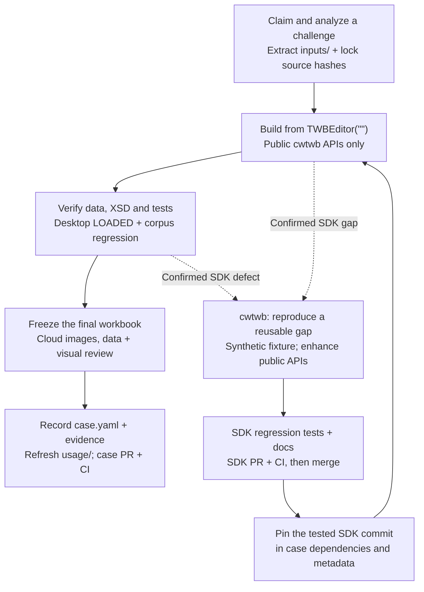

# WoW Tableau Problem-Solving Lab

An open, AI-assisted laboratory for understanding and rebuilding Workout
Wednesday Tableau cases with `cwtwb`.

The project code is licensed under AGPL-3.0-or-later. Third-party articles,
Tableau workbooks, screenshots, and datasets retain their original ownership
and are not relicensed by this repository; see `THIRD_PARTY_ASSETS.md`.

Functional correctness is the primary goal. Interaction correctness and a
repeatable build come next; pixel-level visual parity is optional unless a
visual difference changes the answer or makes the workbook unusable.

“Training” in this repository means improving the case workflow, skills, and
tools through evidence from real cases. It does not mean model fine-tuning.

## Contribution loop

The case repository supplies real challenges and acceptance evidence; the
[cwtwb SDK](https://github.com/aidatacooper/cwtwb) supplies reusable workbook
building APIs. Confirmed SDK gaps feed back into the next case build.



The author workbook is an analysis and comparison reference, never a build
template. Case API usage errors return to the builder; only confirmed SDK
defects or reusable gaps enter the SDK loop. Partial or blocked cases can also
be submitted with explicit remaining work. A rebuild changes the artifact hash,
so capture Cloud evidence after the final build. Desktop checks run locally;
GitHub CI does not replace Desktop or Cloud acceptance.

For the operational steps, see [Start a case](docs/start-a-case.md) and the
[cross-repository workflow](docs/iterating-cwtwb-and-wow.md).

Start with [CONTRIBUTING.md](CONTRIBUTING.md). Agents also read [AGENTS.md](AGENTS.md).
The complete protocol is in
[`docs/protocols/community-case-contribution-v1.md`](docs/protocols/community-case-contribution-v1.md).
The contribution guide also defines when case evidence is strong enough to
become a separate upstream cwtwb issue or pull request.

## Prepare and validate a case

```bash
python -m pip install -r requirements.txt
python scripts/prepare_case.py \
  --source path/to/author.twbx \
  --iteration-id YYYY-MM-DD-wwNN-short-slug \
  --challenge-year YYYY \
  --case-id wow-YYYY-wwNN-short-slug \
  --post posts/YYYY-MM-DD-article.html

python scripts/validate_iteration.py iterations/<iteration-id>
python -m unittest discover -s tests -v
```

For a single remote case, the preparation command can download the workbook
temporarily and remove it after extracting data:

```bash
python scripts/prepare_case.py \
  --workbook-url "https://public.tableau.com/views/WORKBOOK/VIEW" \
  --iteration-id YYYY-MM-DD-wwNN-short-slug \
  --challenge-year YYYY \
  --case-id wow-YYYY-wwNN-short-slug \
  --post-url "https://example.com/article"
```

The preparation command extracts supported packaged data files into `inputs/`
and writes `inputs/source-lock.json`. It never copies the author's workbook.
After analysis, the builder may read extracted inputs, the written analysis,
blank templates, and cwtwb, but it must not reopen the author TWB/TWBX.

## Refresh the source archive incrementally

Use one command to discover new blog posts, rebuild the Tableau Public link
map, and download only missing workbooks or views:

```bash
python download_all.py --refresh
```

The incremental behavior uses stable identities:

- Posts are identified by canonical article URL, not by title or filename.
- A changed title reuses the existing local file instead of creating a copy.
- Limited crawls preserve older entries that were not revisited.
- Tableau workbooks and PNG views are skipped when their existing files are
  non-empty.
- A newly discovered view is downloaded even when its workbook already exists.

For rate-limited runs:

```bash
python download_all.py --refresh --max-items 25 --workers 1 --delay 1.2
```

`crawler.py` can also be run alone. `gen_links_map.py` then regenerates the
JSON, CSV, and Markdown link-map outputs from all local posts.

## Repository layout

```text
.github/                 Issue, PR, and CI configuration
docs/protocols/          Case contribution protocols
iterations/_template/    Starting point for a new case
iterations/<case>/       Analysis, builder, verifier, inputs, and outputs
scripts/prepare_case.py  Extract source data and create a case project
scripts/validate_iteration.py
                         Enforce provenance and run case validation
posts/                   Downloaded article HTML (generated, ignored)
dashboards/              Downloaded TWBX/PNG assets (generated, ignored)
usage/                   Generated active catalogue and consumption view
archive/                 Archived pilots excluded from active case counts
```

The main source tools are:

- `crawler.py`: incrementally archive WordPress posts.
- `gen_links_map.py`: extract and normalize Tableau Public links.
- `download_all.py`: primary resumable HTTP downloader.
- `build_dataset.py`: build the normalized, hash-verified dataset.
- `download_dashboards.py`: browser-based screenshot fallback.

## Publishing this lab as a standalone repository

This directory contains the repository-level README, dependencies, agent rules,
contribution guide, templates, and CI needed for a standalone project. To retain
its history from the parent `backup` repository:

```bash
git subtree split \
  --prefix=labs/wow-tableau-problem-solving \
  -b cwtwb-wow-lab
```

Review redistribution rights for posts, author workbooks, and extracted data.
When redistribution is not permitted, commit URLs, hashes, and acquisition
scripts instead of the original assets.

## Scope and known limits

- The source site is WordPress.com; the crawler reads public archive HTML with
  `urllib` and stops at the pagination boundary.
- Tableau Public links occur in both modern `/app/profile/.../viz/WB/VIEW` and
  legacy `#!/vizhome/WB/VIEW` forms; the link generator supports both.
- Tableau preview PNG endpoints may return a generic placeholder. Such images
  are evidence of acquisition only, not a visual acceptance baseline.
- `case.yaml` is the editable source of truth for case identity and status.
  `usage/case-index.json` and `usage/consumed-cases.json` are generated views.
  Research, replication and verification statuses remain distinct.
- Author links are classified conservatively. Uncertain ownership remains
  marked for manual review.

Historical protocol drafts and iteration notes remain useful evidence, but the
community protocol above is the current contribution contract.

## Case identities and indexes

Follow [the identity and naming rules](docs/protocols/case-identity-and-naming.md). Formal folders retain the
article publication date; canonical IDs include the explicit challenge year.
Maintain `case.yaml` as the editable status source and regenerate both indexes
with `python scripts/case_catalogue.py --write`. Include generated index changes
with the case change; archived pilots and legacy aliases do not add active cases.

Additional independent cases: [five-case Cloud review](docs/five-case-cloud-review.md) (2019 WW46/47/48 and 2026 WW07/09).
